# Feature selection with filter methods for an IDS flow dataset

Project "Arquitectura IDS impulsada por IA". Author: Laura Camila Herrera
Murillo. Course: [NOMBRE DEL CURSO]. Professor: [NOMBRE]. Date: 2026-10-14.

All numbers in this report are read from the result files under
`results/`; the scripts that produce them are listed in section 9.

## 1. Summary

- Three filter methods were applied to two flow datasets (A, captured with a
  firewall; B, without): Low Variance, Pearson correlation and Chi-square.
  Each filter was fitted on training rows only and each resulting feature
  subset was evaluated with the same RandomForest.
- No filter improves the model. What the filters achieve is a smaller input
  at no measurable cost: the final lists have **20 features for A** and
  **30 for B** (of 77) and score F1-macro 0.9678 and
  0.9701 on test, against 0.9713 and 0.9669 with all
  features. The differences are smaller than the fold-to-fold noise measured
  in cross-validation (standard error about 0.0072).
- The combined pipeline (Low Variance, then Pearson, then Chi-square) reaches
  the baseline with fewer features than Chi-square alone (20 against 40 in
  A, 30 against 40 in B), because Chi-square alone fills its top ranks
  with redundant features.
- **The scores must not be read as attack detection ability.** The features
  identify which of the two data sources a row comes from almost perfectly,
  and labels that name the same attack in the two sources are never confused
  with each other. Section 8 explains this and the other limitations.

## 2. Data and preparation

Each dataset joins rows from an external dataset (IDS2025) with flows
captured in a virtual lab, extracted with `cicflowmeter`: 79 features and the
target `newLabel` with 12 labels. A and B are processed separately with the
same code.

| Step | A | B |
|---|---|---|
| Raw rows | 370,545 | 345,192 |
| Exact duplicates removed (after dropping the port columns) | 35,062 | 36,079 |
| Clean rows | 335,314 | 308,940 |
| Train rows (stratified, 20% test, seed 42) | 268,251 | 247,152 |
| Test rows | 67,063 | 61,788 |

Cleaning removed the two port columns (shortcuts), rows with NaN or Inf,
exact duplicates and rows with contradictory labels, leaving 77 features.
Details and justifications are in `cleaning_notes.md` and `decisions.md`.

## 3. What each filter does

Filters score features with statistics computed from the data. They are not
models and nothing is trained. All three were fitted on training rows only.

**Low Variance.** A feature that takes almost the same value in every row
cannot separate classes. Raw variance depends on the unit of each feature, so
the rule used is the share of rows taken by the most frequent value: a
feature is dropped when one value covers at least 99.9% of the training
rows. This removes 9 features in both datasets: the 5 constant
columns and 4 flag counters with 1 to 4 non-zero rows. A looser threshold
(99%) was rejected because it removes `Fwd PSH Flags` and `SYN Flag Count`,
which are non-zero in 22.5% of the `Brute Force` rows: with this class
imbalance a quasi-constant feature can be the signal of a small class. The
variance after MinMax scaling was computed and discarded as a rule, because
it penalizes features with extreme values rather than uninformative ones
(`decisions.md`, decision 6).

**Pearson correlation.** Two features with an absolute correlation close to 1
carry the same information. For every group of features correlated above the
threshold (0.90, 0.95 and 0.99 were tried) only one is kept: the one with the
highest ANOVA F score against the label. Constant features have no defined
correlation, so this filter cannot remove them.

**Chi-square.** Measures the association between a feature and the label in
a table of counts. The features are continuous, so each one is first cut into
10 quantile bins with edges learned on train; without this step the score
would depend on the unit of measure. Features are ranked by the statistic and
the top k are kept (k = 10, 20, 30, 40). The scores were cross-checked
against the classic contingency-table test of SciPy for every feature.
A second ranking by Cramer's V (the same statistic corrected for sample size
and number of bins) was evaluated as a comparison.

**Combined pipeline.** Low Variance at 99.9%, then Pearson on the survivors,
then the top k survivors by Chi-square.

## 4. Evaluation protocol

- Model: `RandomForestClassifier` with 200 trees and
  `class_weight="balanced"`, identical for every subset and not tuned.
- Metrics: F1-macro, PR-AUC macro, MCC and per-class recall. Accuracy is not
  reported as a main metric because the two largest classes hold about 70% of
  the rows.
- Settings are compared with stratified 5-fold cross-validation inside
  train; the filters are refitted in every fold.
- Selection rule, fixed before seeing results: within each family, the
  setting with the fewest features whose mean F1-macro is within one standard
  error of the best one.
- The test rows are used once, for the baseline and the selected setting of
  each family.

## 5. Comparison

### 5.1 Cross-validation inside train (all configurations)

Mean of 5 folds; F1-macro is shown with its standard error.
`combined_pX_kY` means Pearson threshold X and top Y by Chi-square.

| Configuration | A feat. | A F1-macro | A PR-AUC | A MCC | B feat. | B F1-macro | B PR-AUC | B MCC |
|---|---|---|---|---|---|---|---|---|
| `baseline` | 77 | 0.9618 ± 0.0072 **(selected)** | 0.9789 | 0.9938 | 77 | 0.9675 ± 0.0081 **(selected)** | 0.9830 | 0.9928 |
| `variance_qc_0.999` | 68 | 0.9621 ± 0.0074 **(selected)** | 0.9794 | 0.9939 | 68 | 0.9677 ± 0.0081 **(selected)** | 0.9824 | 0.9930 |
| `pearson_0.90` | 45 | 0.9630 ± 0.0075 **(selected)** | 0.9792 | 0.9936 | 46 | 0.9574 ± 0.0076 **(selected)** | 0.9753 | 0.9932 |
| `pearson_0.95` | 52 | 0.9613 ± 0.0077 | 0.9759 | 0.9942 | 51 | 0.9612 ± 0.0081 | 0.9827 | 0.9934 |
| `pearson_0.99` | 61 | 0.9633 ± 0.0073 | 0.9789 | 0.9940 | 61 | 0.9611 ± 0.0076 | 0.9805 | 0.9929 |
| `chi2_top_10` | 10 | 0.8627 ± 0.0091 | 0.8903 | 0.9618 | 10 | 0.8707 ± 0.0048 | 0.8823 | 0.9633 |
| `cramers_v_top_10` | 10 | 0.4396 ± 0.0056 | 0.5127 | 0.2685 | 10 | 0.4198 ± 0.0104 | 0.4976 | 0.2802 |
| `chi2_top_20` | 20 | 0.9250 ± 0.0079 | 0.9574 | 0.9849 | 20 | 0.9254 ± 0.0056 | 0.9555 | 0.9831 |
| `cramers_v_top_20` | 20 | 0.9046 ± 0.0050 | 0.9178 | 0.9731 | 20 | 0.9022 ± 0.0037 | 0.9139 | 0.9726 |
| `chi2_top_30` | 30 | 0.9253 ± 0.0081 | 0.9577 | 0.9862 | 30 | 0.9242 ± 0.0057 | 0.9555 | 0.9845 |
| `cramers_v_top_30` | 30 | 0.9475 ± 0.0078 | 0.9759 | 0.9856 | 30 | 0.9606 ± 0.0048 **(selected)** | 0.9718 | 0.9896 |
| `chi2_top_40` | 40 | 0.9594 ± 0.0078 **(selected)** | 0.9710 | 0.9940 | 40 | 0.9576 ± 0.0080 **(selected)** | 0.9717 | 0.9928 |
| `cramers_v_top_40` | 40 | 0.9682 ± 0.0075 **(selected)** | 0.9800 | 0.9943 | 40 | 0.9618 ± 0.0085 | 0.9803 | 0.9928 |
| `combined_p0.90_k10` | 10 | 0.9266 ± 0.0067 | 0.9513 | 0.9839 | 10 | 0.9198 ± 0.0058 | 0.9514 | 0.9828 |
| `combined_p0.90_k20` | 20 | 0.9613 ± 0.0067 **(selected)** | 0.9687 | 0.9937 | 20 | 0.9548 ± 0.0077 | 0.9673 | 0.9932 |
| `combined_p0.90_k30` | 30 | 0.9662 ± 0.0077 | 0.9820 | 0.9936 | 30 | 0.9676 ± 0.0080 **(selected)** | 0.9789 | 0.9933 |
| `combined_p0.95_k10` | 10 | 0.9218 ± 0.0073 | 0.9539 | 0.9846 | 10 | 0.9225 ± 0.0050 | 0.9544 | 0.9814 |
| `combined_p0.95_k20` | 20 | 0.9244 ± 0.0073 | 0.9580 | 0.9859 | 20 | 0.9533 ± 0.0060 | 0.9702 | 0.9910 |
| `combined_p0.95_k30` | 30 | 0.9586 ± 0.0076 | 0.9705 | 0.9943 | 30 | 0.9672 ± 0.0083 | 0.9812 | 0.9932 |
| `combined_p0.99_k10` | 10 | 0.9072 ± 0.0078 | 0.9570 | 0.9807 | 10 | 0.8974 ± 0.0061 | 0.9354 | 0.9753 |
| `combined_p0.99_k20` | 20 | 0.9275 ± 0.0075 | 0.9592 | 0.9860 | 20 | 0.9232 ± 0.0038 | 0.9554 | 0.9832 |
| `combined_p0.99_k30` | 30 | 0.9614 ± 0.0069 | 0.9687 | 0.9942 | 30 | 0.9580 ± 0.0082 | 0.9734 | 0.9929 |

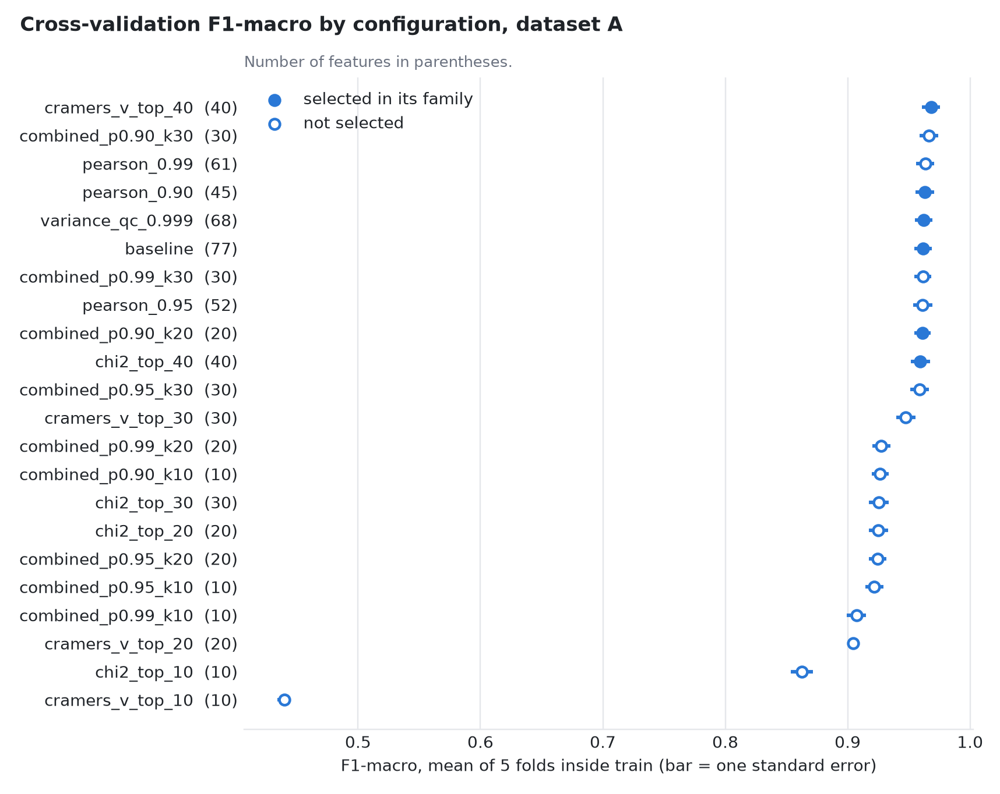
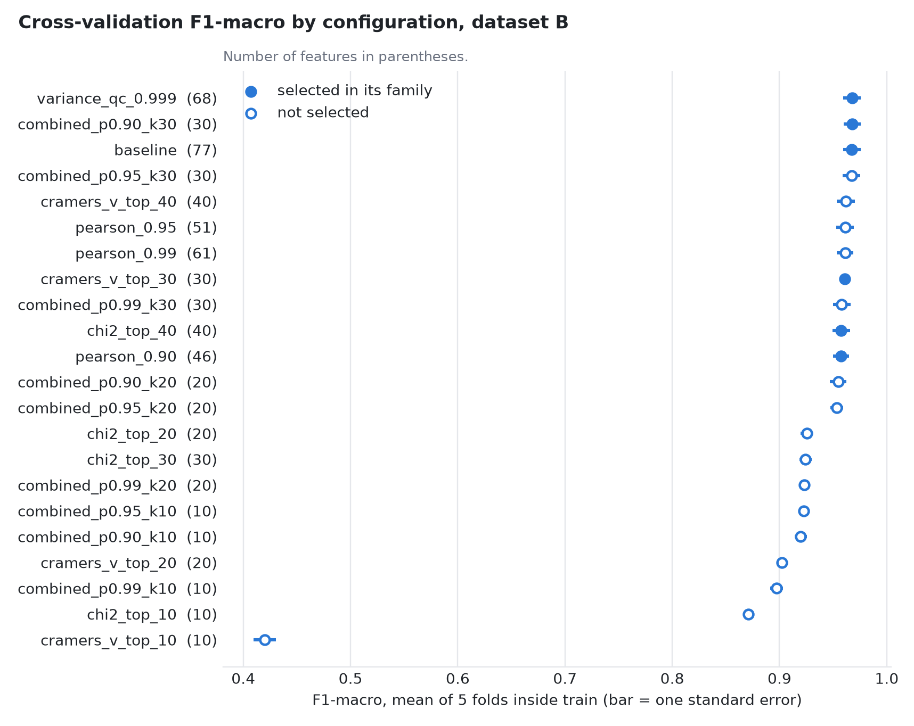

### 5.2 Test (baseline and the selected setting of each family)

| Dataset | Configuration | Features | F1-macro | PR-AUC macro | MCC | Train time (s) |
|---|---|---|---|---|---|---|
| A | `baseline` | 77 | 0.9713 | 0.9688 | 0.9939 | 19.0 |
| A | `variance_qc_0.999` | 68 | 0.9721 | 0.9685 | 0.9941 | 21.6 |
| A | `pearson_0.90` | 45 | 0.9727 | 0.9685 | 0.9938 | 14.3 |
| A | `chi2_top_40` | 40 | 0.9659 | 0.9575 | 0.9940 | 16.0 |
| A | `cramers_v_top_40` | 40 | 0.9715 | 0.9691 | 0.9944 | 15.0 |
| A | `combined_p0.90_k20` | 20 | 0.9678 | 0.9650 | 0.9939 | 13.7 |
| B | `baseline` | 77 | 0.9669 | 0.9682 | 0.9927 | 19.9 |
| B | `variance_qc_0.999` | 68 | 0.9683 | 0.9656 | 0.9928 | 19.8 |
| B | `pearson_0.90` | 46 | 0.9692 | 0.9676 | 0.9932 | 15.5 |
| B | `cramers_v_top_30` | 30 | 0.9540 | 0.9586 | 0.9892 | 9.5 |
| B | `chi2_top_40` | 40 | 0.9621 | 0.9674 | 0.9927 | 19.9 |
| B | `combined_p0.90_k30` | 30 | 0.9701 | 0.9661 | 0.9932 | 15.7 |

### 5.3 Recall per class on test, baseline against the final list

| Label | A test rows | A baseline | A final | B test rows | B baseline | B final |
|---|---|---|---|---|---|---|
| Botnet ARES | 275 | 0.971 | 0.982 | 275 | 0.971 | 0.989 |
| Brute Force | 1378 | 1.000 | 1.000 | 1378 | 0.999 | 1.000 |
| Dos/DDos | 4273 | 0.997 | 0.998 | 4273 | 0.998 | 0.998 |
| Infiltration | 6 | 0.667 | 0.667 | 6 | 0.667 | 0.667 |
| PortScan | 111 | 0.982 | 0.982 | 111 | 0.973 | 0.982 |
| Web Attack | 406 | 0.993 | 0.993 | 406 | 0.993 | 0.993 |
| benign | 20834 | 0.988 | 0.990 | 20560 | 0.988 | 0.989 |
| bruteforce | 13344 | 1.000 | 1.000 | 8422 | 1.000 | 1.000 |
| dos_httpflood | 25403 | 0.999 | 0.998 | 24706 | 0.999 | 0.999 |
| dos_slowhttptest | 165 | 1.000 | 1.000 | 164 | 1.000 | 1.000 |
| recon | 857 | 0.995 | 0.988 | 1476 | 0.997 | 0.997 |
| sqli | 11 | 1.000 | 1.000 | 11 | 1.000 | 1.000 |

Reading of the results:

- Low Variance and Pearson remove 9 to 32 features with no consistent
  change: the largest gap to the baseline in cross-validation is 0.010 in
  F1-macro (Pearson 0.90 in B, standard error 0.008) and it does not appear
  on test. The baseline was not being hurt by redundant features: a tree
  ensemble tolerates them.
- Chi-square alone needs 40 features to reach the baseline; with 10 or 20 it
  is clearly worse.
- The ranking by Cramer's V is not a better alternative: with 10 features its
  F1-macro falls to 0.44 (A), 0.42 (B) and it detects no `sqli` row.
- The largest single error of the baseline is 200 `benign` rows predicted as `Dos/DDos` in A and 203 `benign` rows predicted as `Dos/DDos`
  in B.

## 6. Why the combined pipeline beats Chi-square alone

Chi-square scores each feature on its own. Two features that are copies of
each other get the same high score and both enter the top k, although the
second one adds nothing. Evidence, for the same number of features:

| | A (k = 20) | B (k = 30) |
|---|---|---|
| F1-macro in cross-validation, Chi-square top k | 0.9250 | 0.9242 |
| F1-macro in cross-validation, combined top k | 0.9613 | 0.9676 |
| Feature pairs with absolute correlation above 0.90 inside Chi-square top k | 21 | 34 |
| Same, inside the combined list | 0 | 0 |
| Features present in both the Chi-square top k and the combined list | 6 | 13 |

The top of the Chi-square ranking is occupied by groups such as
`Total Length of Fwd Packets` and `Subflow Fwd Bytes`, or
`Fwd Packet Length Mean` and `Avg Fwd Segment Size`, which are the same
quantity under two names. The combined pipeline lets Pearson keep one
feature per group first, so each of the k places goes to different
information.

## 7. Final feature lists

Chosen by the selection rule: `combined_p0.90_k20` for A and `combined_p0.90_k30` for B. The
rule was not adjusted after seeing the results (`decisions.md`, decision 8),
which is why the two lists have different lengths. The lists were fitted on
the full training set of each dataset and are saved as
`results/final_features_A.csv` and `results/final_features_B.csv`.

### Dataset A (20 features)

| Rank | Feature | Chi-square | Cramer's V | In the other list |
|---|---|---|---|---|
| 1 | `Total Length of Fwd Packets` | 684,568 | 0.565 | yes |
| 2 | `Fwd Packet Length Mean` | 643,034 | 0.632 | yes |
| 3 | `Max Packet Length` | 635,350 | 0.628 | yes |
| 4 | `Fwd IAT Mean` | 552,886 | 0.479 | yes |
| 5 | `Fwd IAT Total` | 498,573 | 0.454 | no |
| 6 | `Flow Packetss` | 495,073 | 0.453 | yes |
| 7 | `Fwd Header Length` | 484,335 | 0.549 | yes |
| 8 | `Total Fwd Packets` | 483,129 | 0.548 | yes |
| 9 | `Flow Bytess` | 469,214 | 0.441 | yes |
| 10 | `Packet Length Mean` | 468,722 | 0.591 | no |
| 11 | `Idle Max` | 267,288 | 0.499 | no |
| 12 | `Idle Mean` | 266,483 | 0.498 | yes |
| 13 | `Idle Std` | 240,515 | 0.473 | yes |
| 14 | `Active Max` | 232,852 | 0.466 | no |
| 15 | `Active Min` | 206,749 | 0.439 | yes |
| 16 | `Flow IAT Min` | 198,537 | 0.430 | yes |
| 17 | `Init_Win_bytes_backward` | 198,103 | 0.608 | yes |
| 18 | `Fwd IAT Min` | 181,074 | 0.411 | yes |
| 19 | `Init_Win_bytes_forward` | 175,271 | 0.572 | yes |
| 20 | `Min Packet Length` | 158,262 | 0.768 | yes |

### Dataset B (30 features)

| Rank | Feature | Chi-square | Cramer's V | In the other list |
|---|---|---|---|---|
| 1 | `Total Length of Fwd Packets` | 602,592 | 0.552 | yes |
| 2 | `Average Packet Size` | 568,494 | 0.619 | no |
| 3 | `Fwd Packet Length Mean` | 494,064 | 0.632 | yes |
| 4 | `Idle Mean` | 488,277 | 0.497 | yes |
| 5 | `Max Packet Length` | 478,543 | 0.622 | yes |
| 6 | `Flow Packetss` | 452,778 | 0.451 | yes |
| 7 | `Flow IAT Mean` | 451,824 | 0.451 | no |
| 8 | `Flow Duration` | 445,525 | 0.448 | no |
| 9 | `Fwd IAT Mean` | 429,245 | 0.439 | yes |
| 10 | `Flow Bytess` | 411,823 | 0.430 | yes |
| 11 | `Idle Std` | 364,752 | 0.430 | yes |
| 12 | `Fwd Header Length` | 336,172 | 0.522 | yes |
| 13 | `Total Fwd Packets` | 288,740 | 0.540 | yes |
| 14 | `Active Min` | 261,817 | 0.515 | yes |
| 15 | `Active Mean` | 243,260 | 0.496 | no |
| 16 | `Init_Win_bytes_backward` | 181,329 | 0.606 | yes |
| 17 | `Flow IAT Min` | 174,425 | 0.376 | yes |
| 18 | `Init_Win_bytes_forward` | 174,182 | 0.594 | yes |
| 19 | `Min Packet Length` | 143,281 | 0.761 | yes |
| 20 | `Fwd Packet Length Min` | 143,193 | 0.761 | no |
| 21 | `Bwd IAT Total` | 142,165 | 0.758 | no |
| 22 | `Bwd IAT Mean` | 141,991 | 0.758 | no |
| 23 | `Subflow Bwd Bytes` | 124,241 | 0.709 | no |
| 24 | `Bwd IAT Min` | 118,020 | 0.691 | no |
| 25 | `Bwd Packet Length Mean` | 106,954 | 0.658 | no |
| 26 | `Fwd IAT Min` | 91,347 | 0.304 | yes |
| 27 | `Bwd Packetss` | 83,502 | 0.581 | no |
| 28 | `Down Up Ratio` | 66,174 | 0.517 | no |
| 29 | `Protocol` | 61 | 0.016 | no |
| 30 | `Bwd Packet Length Min` | 0 | 0.000 | no |

### A against B

- Shared (16): `Active Min`, `Flow Bytess`, `Flow IAT Min`, `Flow Packetss`, `Fwd Header Length`, `Fwd IAT Mean`, `Fwd IAT Min`, `Fwd Packet Length Mean`, `Idle Mean`, `Idle Std`, `Init_Win_bytes_backward`, `Init_Win_bytes_forward`, `Max Packet Length`, `Min Packet Length`, `Total Fwd Packets`, `Total Length of Fwd Packets`
- Only in A (4): `Active Max`, `Fwd IAT Total`, `Idle Max`, `Packet Length Mean`
- Only in B (14): `Active Mean`, `Average Packet Size`, `Bwd IAT Mean`, `Bwd IAT Min`, `Bwd IAT Total`, `Bwd Packet Length Mean`, `Bwd Packet Length Min`, `Bwd Packetss`, `Down Up Ratio`, `Flow Duration`, `Flow IAT Mean`, `Fwd Packet Length Min`, `Protocol`, `Subflow Bwd Bytes`

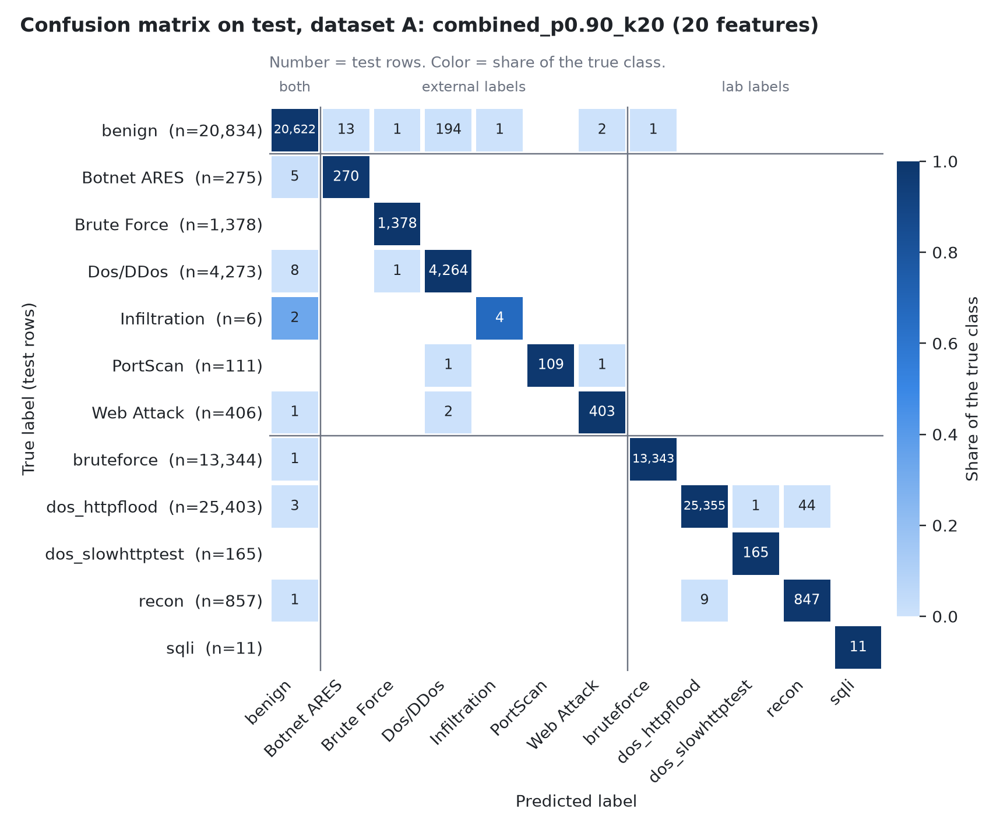

In the confusion matrices the labels are ordered by data source. Every
misclassification falls inside one source block or involves `benign`, the
only label present in both sources.

## 8. Limitations

### 8.1 The features identify the data source

External rows and lab rows come from different environments and different
flow extractors, and the label vocabularies differ (`Brute Force` and
`bruteforce`, `PortScan` and `recon`, `Web Attack` and `sqli`). Two checks
were made:

- **Confusions between equivalent labels:** 0 in total, across
  the 12 configurations scored on test, in either direction.
  If the features described the attack itself, flows of the same attack type
  from the two sources would be confused at least occasionally.
- **Source probe:** a RandomForest with the same settings was trained to
  answer only "external or lab?" using `benign` rows alone, the one label
  present in both sources. With the final lists it misclassifies
  0 of 20,834 test rows in A and 2 of
  20,560 in B.

Part of the reason is visible in the features: 27 of the 77
features are zero in every lab row (see 8.3), so any non-zero value marks an
external row. The final list of A contains 1 of them
(`Init_Win_bytes_backward`) and the final list of B contains 9
(`Init_Win_bytes_backward`, `Bwd IAT Total`, `Bwd IAT Mean`, `Subflow Bwd Bytes`, `Bwd IAT Min`, `Bwd Packet Length Mean`, `Bwd Packetss`, `Down Up Ratio`, `Bwd Packet Length Min`).

Consequence: the model separates the sources and then the classes inside
each source. The high scores do not show that the selected features
characterize an attack type, and they say nothing about traffic from another
network. The experiment that would test it, training on one source and
evaluating on the equivalent labels of the other, was not done.

### 8.2 Infiltration

`Infiltration` has 29 rows in total: 23 in train and 6
in test. On test the model detects 4 of 6 in A and
4 of 6 in B, in every configuration; one row is 17
points of recall. In cross-validation, over the 23 training rows,
recall ranges from 0.57 to 0.70 in A and from 0.52 to 0.70 in B depending on the
configuration. No conclusion about which features help this class can be
drawn from so few rows, and it is the class that limits F1-macro.
`sqli` has 11 test rows after deduplication, so its recall is also
indicative only.

### 8.3 One-direction flows

In 100% of the lab rows the backward packet count is 0 and the flow source
is the server. The client side of every lab conversation is missing: no
attacker requests and no SQL payloads are represented. Another extractor
(NTLFlowLyzer) produces bidirectional flows from the same capture, which
points to a failure of the extraction and not of the capture. That comparison
was verified on a single PCAP (`fw_benign_20260828_01`), not on the 12 lab captures; for
the other 11 it is assumed, not checked. All backward features are constant for
lab rows, and the lab classes are being separated only by what the server
sent.

### 8.4 Duplicates

With the port columns present the raw files have 94 (A) and 100 (B) exact
duplicate rows. Once the ports are dropped, 35,062 (A) and 36,079 (B)
rows are identical to another row and were removed, keeping one copy. The
effect is concentrated: `PortScan` goes from 25,409 rows to 554 and `sqli`
from 179 to 58 (A) and 57 (B). The metrics therefore describe performance
per distinct flow pattern, not per captured flow, and class frequencies no
longer reflect the captured traffic (`decisions.md`, decision 4). Rows that
are almost identical were not removed and can fall on both sides of the
train/test split, which may make test scores optimistic.

### 8.5 Other limits

- **Chi-square and sparse features.** With quantile bins, a feature where one
  value covers about 90% of the rows or more collapses into a single bin and
  gets a score of 0 whatever information it carries. This happens to
  17 non-constant features in A and 16 in B, mostly
  flag counters. In B only 39 features survive Pearson, so the top 30 takes
  most of them and includes one feature with a score of 0
  (`Bwd Packet Length Min`).
- **One model.** The comparison uses a RandomForest. Models that are
  sensitive to redundant features may benefit more from the filters.
- **Five folds.** The standard error used by the selection rule is itself a
  rough estimate.
- **A and B share their external rows,** so results on the two datasets are
  not independent replications.

## 9. Reproducibility

Run in order with `.venv/bin/python`:

| Script | Stage |
|---|---|
| `src/00_setup.py` | Load and check the raw files |
| `src/01_audit.py` | Quality audit |
| `src/02_clean.py`, `src/02b_duplicates_check.py` | Cleaning and duplicate check |
| `src/03_split.py`, `src/03b_handoff.py` | Train/test split and data package |
| `src/04_filters.py` | The three filters on the full training set |
| `src/05_evaluate.py`, `src/05b_plots.py` | Evaluation and figures |
| `src/06_deliverables.py`, `src/06b_report.py` | Final lists and this report |

Parameters are in `src/config.py`. Seeds are fixed. Stages 1 to 4 and 6 were
run twice and produced identical files; stage 5 (about one hour) was run
once.

## Appendix. Confusion matrices of the other configurations scored on test

The matrices of the final lists are in section 7. The ones below belong to
the baseline and to the setting selected in each of the other families.

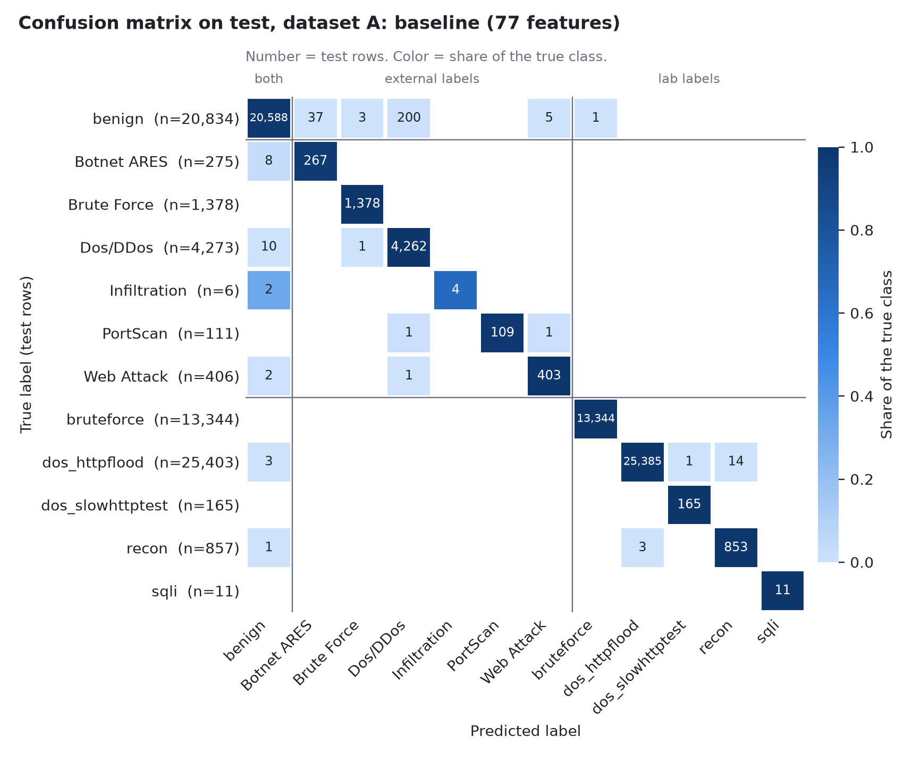
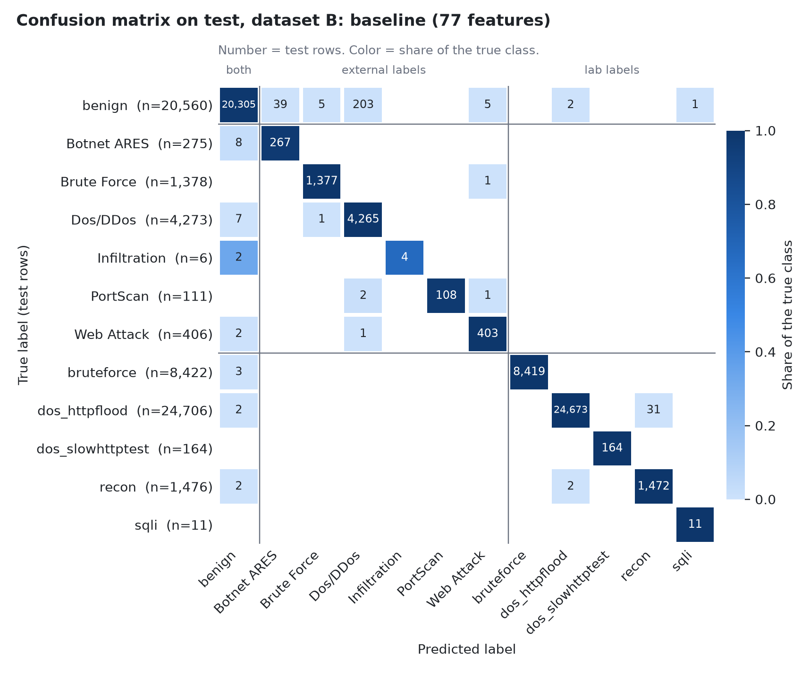

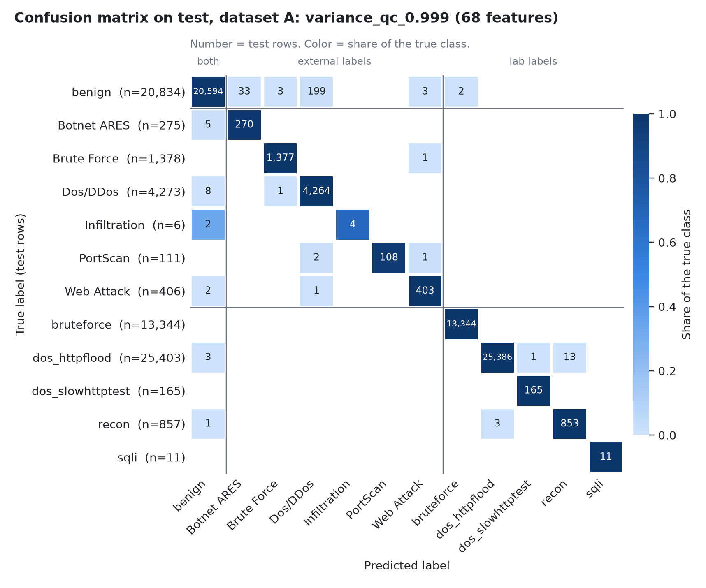
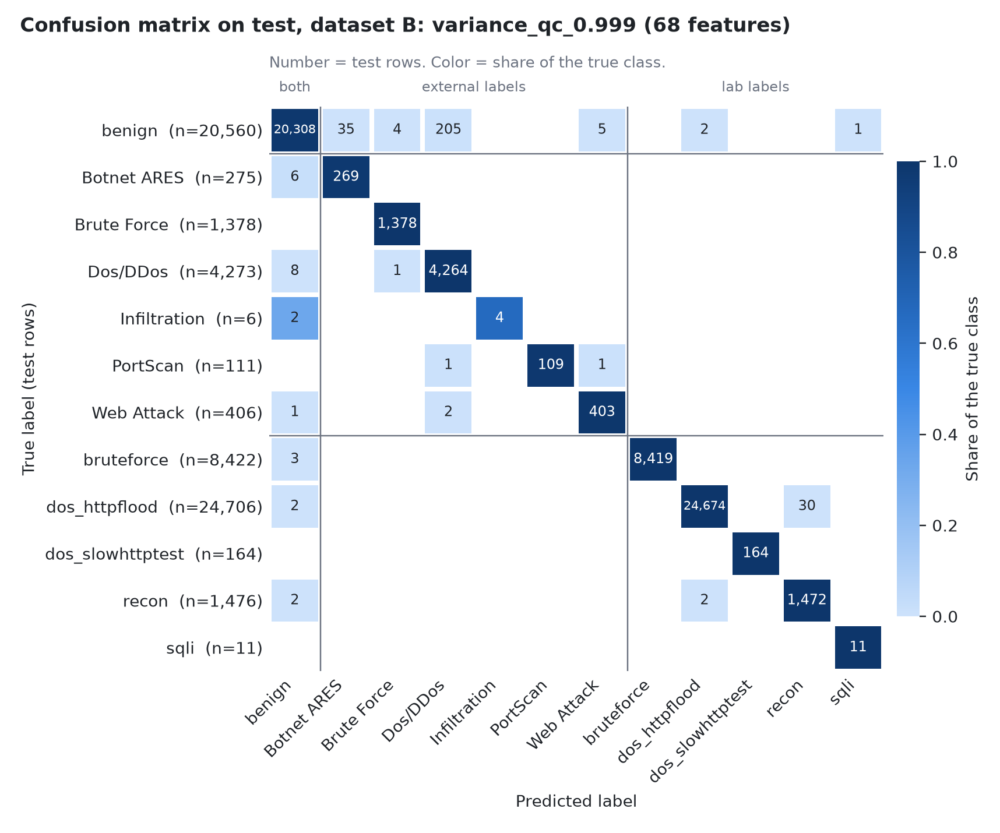

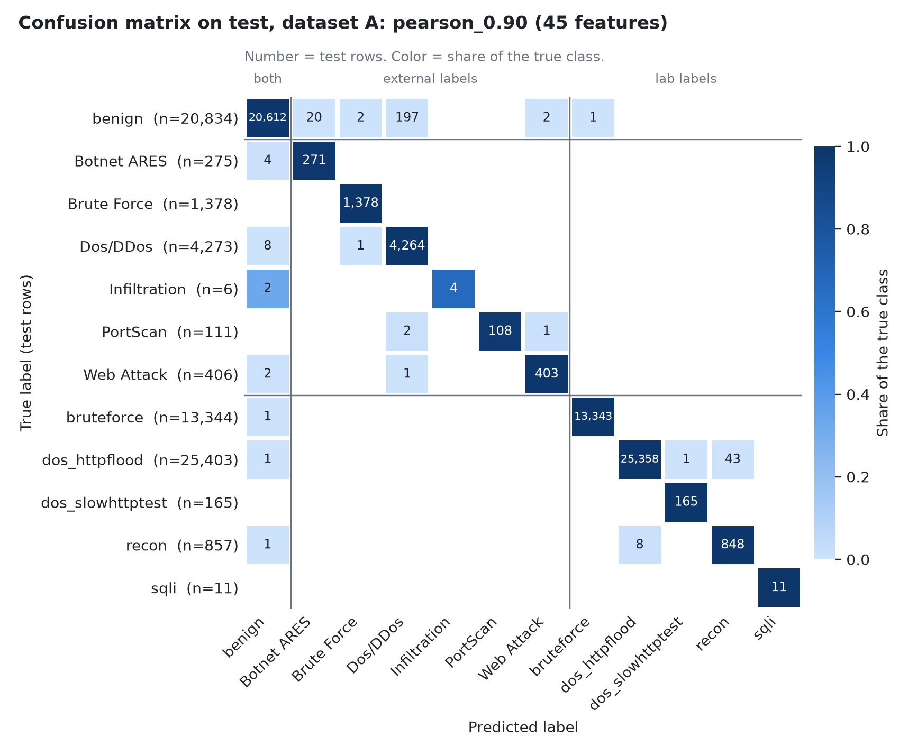
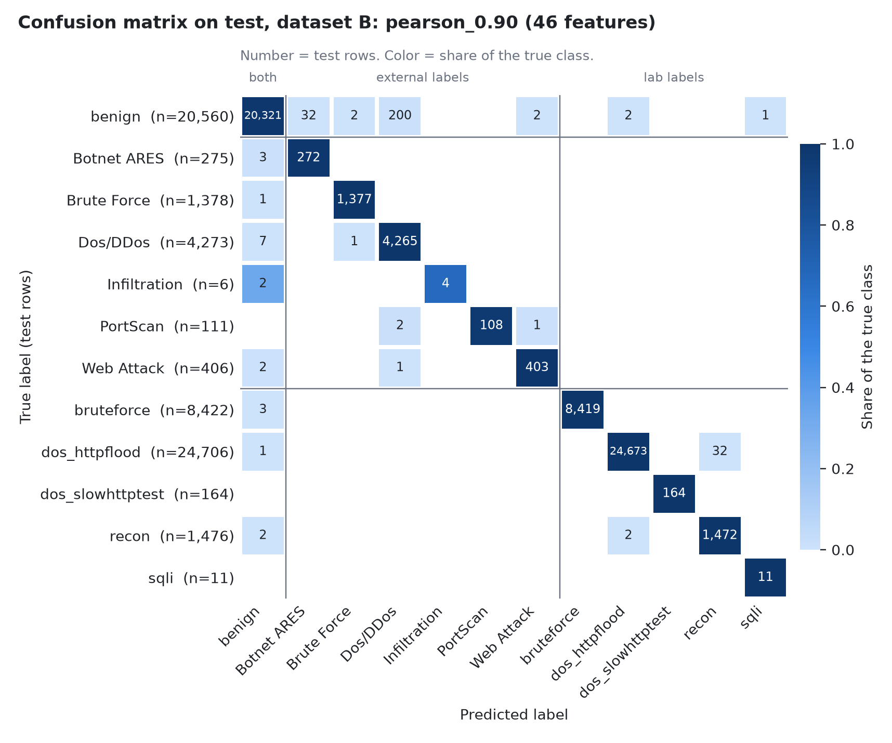

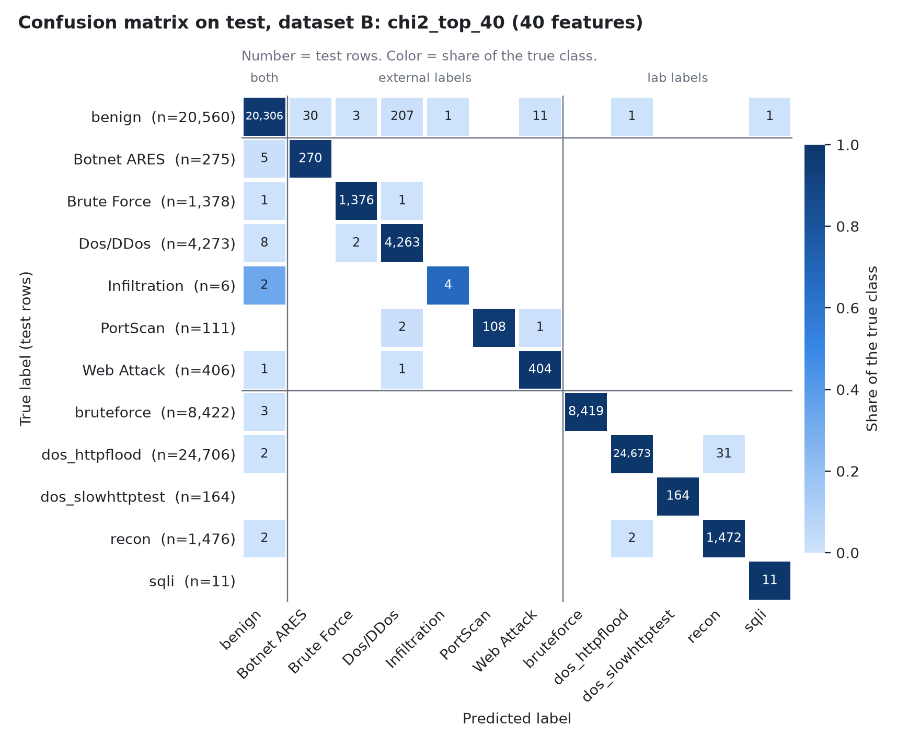

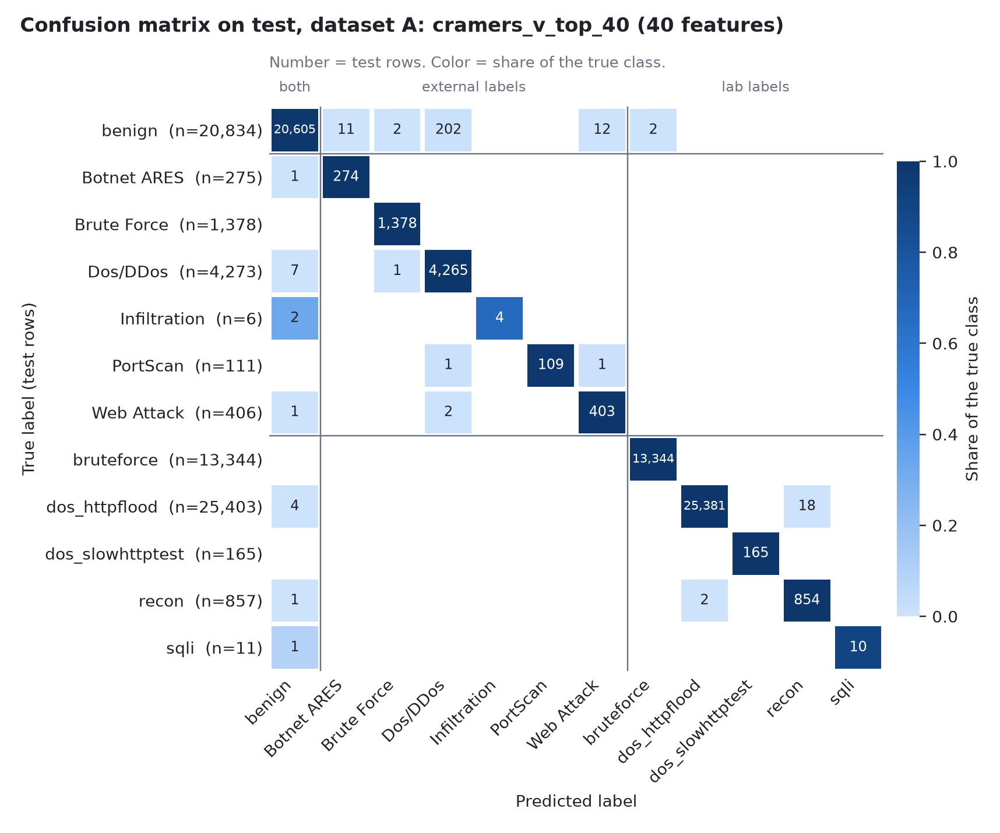
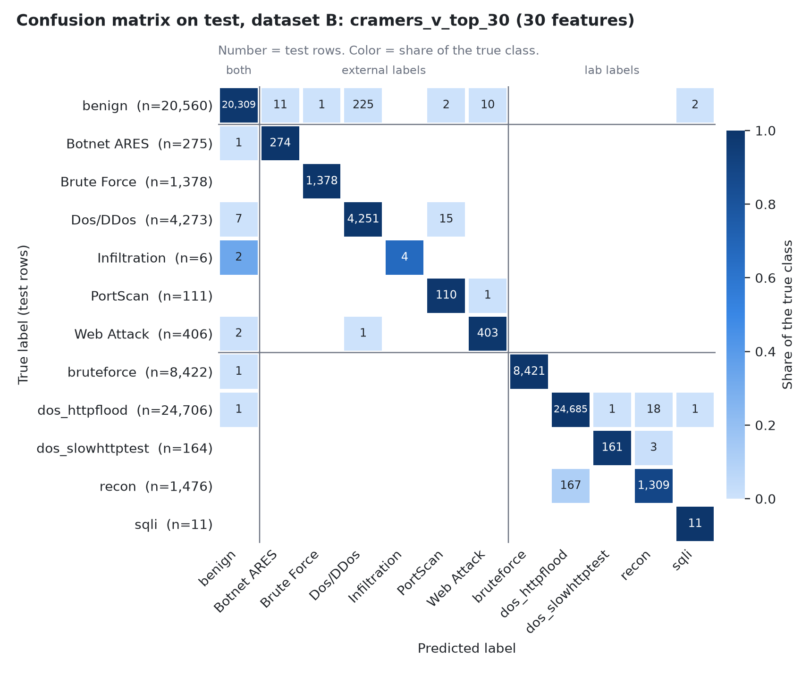
